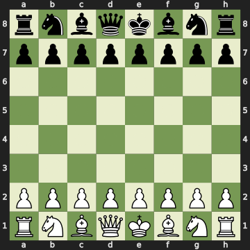

# FastChessEngine

A high-performance chess engine with a C backend and Python API, designed for speed and efficiency. FastChess provides a fast and intuitive interface for chess operations by leveraging a compiled C extension for core logic.

## Features

-   **High Performance**: Critical chess logic, such as move generation and board state manipulation, is implemented in C and accessed via `ctypes`. This significantly outperforms pure Python implementations, as demonstrated in the speed comparisons below.
-   **Pythonic API**: Despite the C backend, the library offers a clean and easy-to-use Python interface, making it accessible for Python developers.
-   **Modular Design**: The codebase is structured for clarity and extensibility, allowing for future enhancements and contributions.
-   **SVG Board Representation**: Includes a feature to render the current board state as an SVG, similar to popular chess libraries, making visualization straightforward.
    
    

## Installation

To install `fastchess-engine`, you will need a C compiler (like GCC on Linux/macOS or MSVC on Windows) available on your system, as the installation process involves compiling the C backend.

1.  **Clone the repository**:
    ```bash
    git clone https://github.com/thefcraft/FastChess.git
    cd FastChess
    ```
2.  **Install using pip**:
    ```bash
    pip install .
    ```
    This command will build the C extension and install the Python package.

## Project Structure

The project is organized as follows:

```
FastChessRepo/
├── fastchess/
│   ├── __init__.py         # Package initializer
│   ├── FastChess.py        # Python interface to the C library and board logic
│   └── FastChess.c         # C implementation of core chess logic
├── demo.py                 # Example usage and Tkinter GUI for the chess engine
├── speedtest.ipynb         # Jupyter notebook for performance benchmarks
├── setup.py                # Package build and installation script
└── README.md               # Project documentation
```

## Usage

Here's a basic example of how to use FastChess to create a board and interact with it:

```python
from fastchess import Board, Move

# Create a new Board instance (starts in the initial chess position by default)
board = Board()

print("Initial board state:")
print(board)

# Generate and print legal moves for the current position (White's turn)
print("\nLegal moves for White:")
for move in board.legal_moves():
    print(move)

# Make a move (e.g., e2e4)
e2e4_move = Move.from_uci('e2e4')
board.push(e2e4_move)

print("\nBoard after e2e4:")
print(board)

# Check if the game is over
if board.is_game_over():
    print("\nGame is over!")
else:
    print("\nGame is still ongoing.")
```

For a full demonstration, including a basic Tkinter GUI and AI play, refer to `demo.py`.

## Speed Comparison (`python-chess` vs `fastchess-engine`)

(The following benchmarks were performed on a specific system and may vary.)

### `legal_moves` generator
`%timeit -n 1000000 board.legal_moves`
> 249 ns ± 11.5 ns per loop (mean ± std. dev. of 7 runs, 1,000,000 loops each)

`%timeit -n 1000000 fastboard.legal_moves()`
> 203 ns ± 45.9 ns per loop (mean ± std. dev. of 7 runs, 1,000,000 loops each)

### `legal_moves` list
`%timeit -n 10000 list(board.legal_moves)`
> 55.7 µs ± 9.5 µs per loop (mean ± std. dev. of 7 runs, 10,000 loops each)

`%timeit -n 10000 list(fastboard.legal_moves())`
> 19.4 µs ± 2.92 µs per loop (mean ± std. dev. of 7 runs, 10,000 loops each)

### `copy` board state
`%timeit -n 100000 board.copy()`
> 3.34 µs ± 255 ns per loop (mean ± std. dev. of 7 runs, 100,000 loops each)

`%timeit -n 100000 fastboard.copy()`
> 1.64 µs ± 255 ns per loop (mean ± std. dev. of 7 runs, 100,000 loops each)

### `push` move (including copy)
`move = list(board.legal_moves)[0]; %timeit -n 100000 board.copy().push(move)`
> 13.6 µs ± 2.63 µs per loop (mean ± std. dev. of 7 runs, 100,000 loops each)

`move = list(fastboard.legal_moves())[0]; %timeit -n 100000 fastboard.copy().push(move)`
> 3.03 µs ± 638 ns per loop (mean ± std. dev. of 7 runs, 100,000 loops each)

### `piece_at` square (raw access)

`%timeit -n 10000 [board.piece_at(square) for square in chess.SQUARES]`
> 35.3 µs ± 3.97 µs per loop (mean ± std. dev. of 7 runs, 10,000 loops each)

`%timeit -n 10000 [fastboard.piece_at_raw(square) for square in range(64)]`
> 44.3 µs ± 9.06 µs per loop (mean ± std. dev. of 7 runs, 10,000 loops each)
*(Note: The raw C `piece_at_raw` is slightly slower here, likely due to Python-C overhead for individual calls. The overall speedup comes from complex operations staying in C.)*

## Contributing

Contributions to FastChessEngine are highly encouraged! If you encounter any bugs, have feature requests, or would like to contribute code, please feel free to open an issue or submit a pull request on the GitHub repository.

## License

FastChessEngine is licensed under the [MIT License](https://github.com/git/git-scm.com/blob/main/MIT-LICENSE.txt).